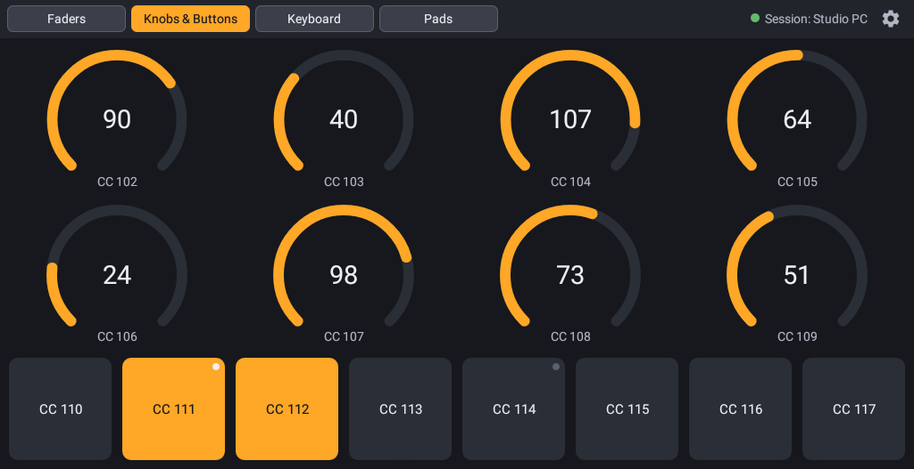

# Faderling

[](https://github.com/duddex/faderling/actions/workflows/ci.yml)

An Android app that turns a tablet into pages of MIDI controls – 10 faders, 8 knobs, 8 buttons, a two-octave keyboard and 16 MPC-style drum pads – sending MIDI Control Change (CC) and note messages over Wi-Fi via RTP-MIDI (AppleMIDI). Your computer sees the tablet as a regular MIDI input, e.g. in Ableton Live.





<details>
<summary>Settings screen</summary>


</details>

## Features

- Four Pages, switched with the tabs in the top bar:
  - **Faders**: 10 vertical faders that glide to the touched position instead of jumping
  - **Knobs & Buttons**: two rows of 4 knobs (drag up/down, relative, no jumps) above a row of 8 square buttons
  - **Keyboard**: 25 keys (two octaves, C to C) sending Note On/Note Off; chords and sliding across keys (glissando); *Oct −/Oct +* shift the range, shown in Ableton's note names (default C2–C4, i.e. notes 48–72)
  - **Pads**: 4×4 MPC-style drum pads (rectangular, up to 1.6 times wider than tall, to use the screen width) sending Note On/Note Off on channel 10, laid out like an Ableton Drum Rack (notes 36–51, C1 bottom left); every touch retriggers (two-finger rolls), sliding onto other Pads does nothing
- Buttons are **Momentary** (on while held) or **Latch** (each press flips on/off); they send 127 for on, 0 for off. Latch Buttons have a small LED in the corner that lights while they are on
- 7-bit CC (0–127), send-only, landscape
- Every Control re-sends its final value shortly after release, and every Note Off is sent twice, to make up for lost Wi-Fi packets; held notes are released when you switch Pages or leave the app
- Per-Control Assignment (name, CC number, MIDI channel, and mode for buttons), plus Keyboard channel and velocity (default 100) and per-Pad name and note with a shared Pad channel and velocity, edited on the settings screen (gear icon); duplicate CC/channel combinations are flagged
- Default CCs: faders 20–29, knobs 102–109, buttons 110–117, all on channel 1
- Advertises itself via Bonjour as **Faderling** plus the device model (e.g. *Faderling KFAUWI*), so several tablets can be told apart; the receiver starts the Session
- Session status shown on the main screen
- Keeps the screen on while a Page is shown (not on the settings screen, where the normal screen timeout applies); plug the tablet in for longer sessions
- Runs on Android 5.1 (API 22) and newer
- Works on phones too: on low screens (less than 450 dp high, e.g. a phone in landscape) the Keyboard shows one octave (C3–C4) with wider Keys; tablets keep two octaves

## Build and install

Requires the Android SDK (`ANDROID_HOME` or `local.properties` with `sdk.dir`) and a JDK 17+.

```powershell
.\gradlew.bat assembleDebug
adb install -r app\build\outputs\apk\debug\app-debug.apk
```

Unit tests and lint:

```powershell
.\gradlew.bat testDebugUnitTest lintDebug
```

Every push and pull request is built by [GitHub Actions](https://github.com/duddex/faderling/actions/workflows/ci.yml); the debug APK can be downloaded from each run's artifacts.

## Connect on Windows

1. Install [rtpMIDI](https://www.tobias-erichsen.de/software/rtpmidi.html) by Tobias Erichsen.
2. Start Faderling on the tablet (same Wi-Fi network as the PC).
3. In rtpMIDI, create a session under *My Sessions* (**+**) and enable it.
4. Select **Faderling &lt;model&gt;** (e.g. *Faderling TB305FU*) in the *Directory* list and click **Connect**. The tablet shows `Session: <PC name>`.
5. In your DAW, enable the rtpMIDI session port as a MIDI input.

On macOS, use *Audio MIDI Setup → MIDI Network Setup* instead of rtpMIDI.

The Session only runs while Faderling is visible. It ends when the app is closed or restarted, when you switch to another app, or when the screen turns off (power button, or the screen timeout while you are on the settings screen); Faderling does no network activity in the background. Click **Connect** in rtpMIDI again afterwards.

## Known issues

- **Lenovo tablets (ZUI): pressing three Controls, Keys or Pads at once takes a screenshot.** Lenovo's three-finger system gestures (swipe down = screenshot, swipe up, spread = split screen, …) are handled by the system before the app sees the touches, and apps cannot turn them off. Disable them on the tablet under *Settings → System → Gestures* (the exact menu depends on the ZUI version), or via ADB:
  ```powershell
  adb shell settings put system three_finger_slide_down_enabled 0
  ```
  Other manufacturers have similar multi-finger gestures; disable them if they get in the way.

## Tools

Python 3, standard library only:

- `tools/fader_monitor.py` – shows every CC arriving on a MIDI input port (e.g. the rtpMIDI session port) as a fader. Windows only.
  ```powershell
  python tools\fader_monitor.py --list
  python tools\fader_monitor.py "My Session"
  ```
- `tools/rtpmidi_probe.py` – connects to the tablet directly as an RTP-MIDI initiator and prints received CC and note messages; useful without rtpMIDI.
  ```powershell
  python tools\rtpmidi_probe.py <tablet-ip>
  ```
- `tools/latency_probe.py` – measures the network latency to the tablet: 200 clock-sync round trips, then the send → arrival time of every MIDI packet while you play. It connects as its own Session, so rtpMIDI can stay connected.
  ```powershell
  python tools\latency_probe.py <tablet-ip>
  ```

## Documentation

- [GLOSSARY.md](GLOSSARY.md) – domain language (Control, Fader, Knob, Button, Keyboard, Key, Pad, Page, Assignment, Session)
- [docs/adr](docs/adr) – architecture decisions

## License

[MIT](LICENSE)
