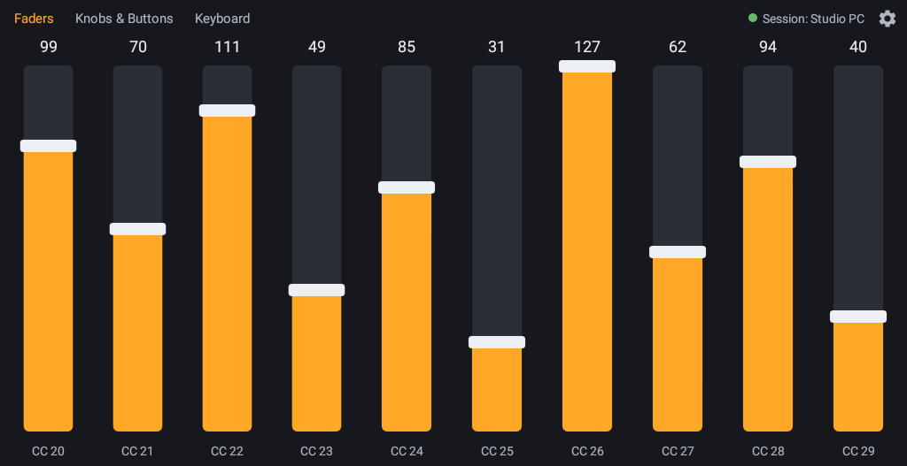
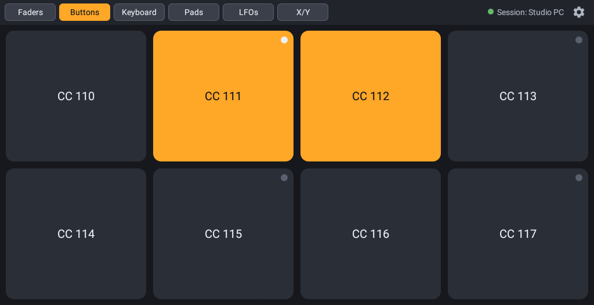
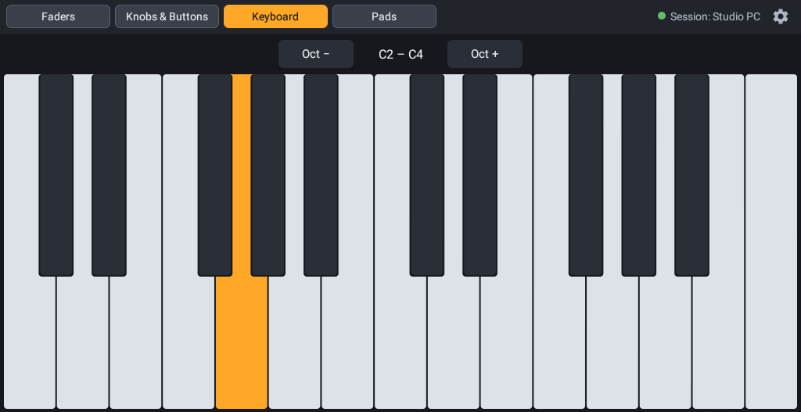
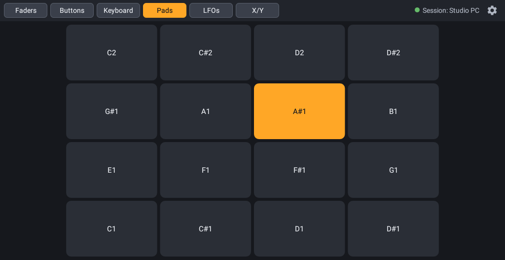
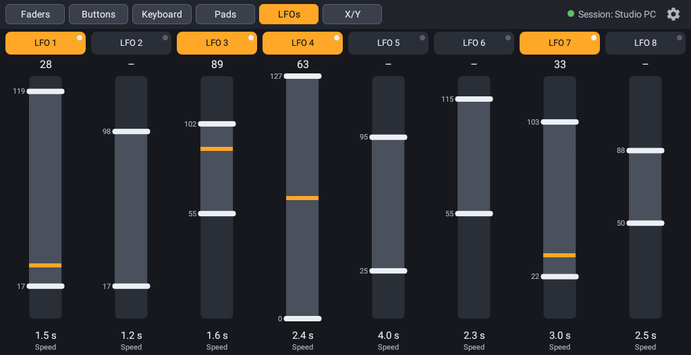
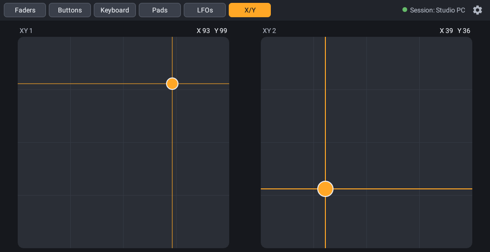
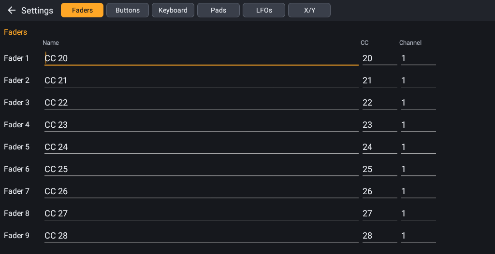
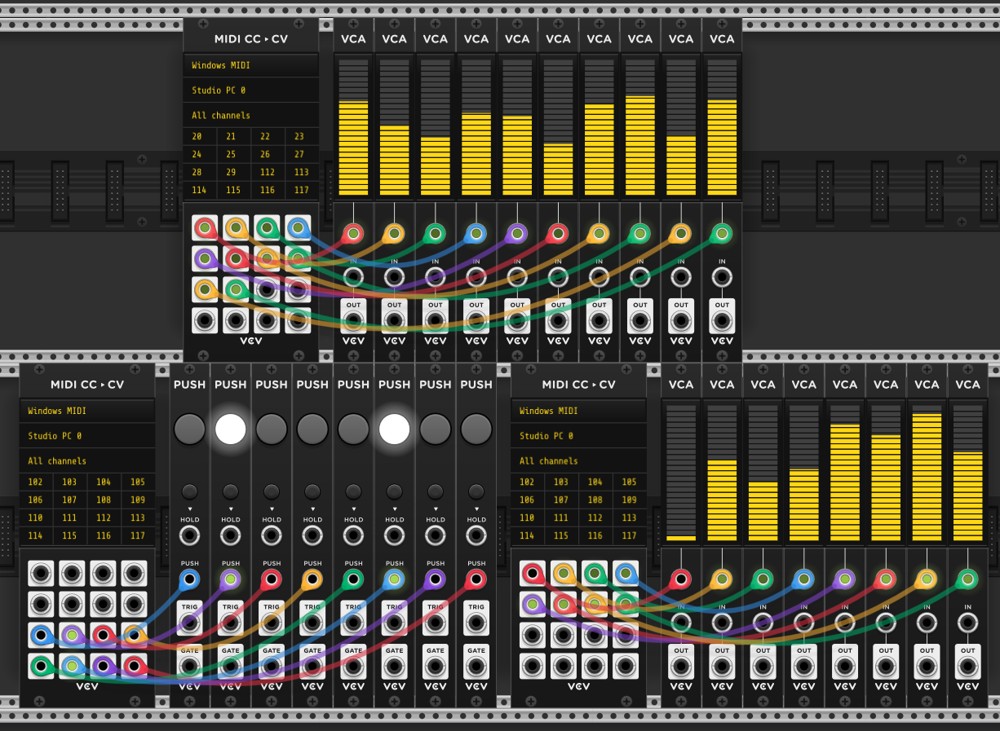

# Faderling

[](https://github.com/duddex/faderling/actions/workflows/ci.yml)

An Android app that turns a tablet into pages of MIDI controls – 10 faders, 8 buttons, a two-octave keyboard, 16 MPC-style drum pads, 8 LFOs and 2 XY Pads – sending MIDI Control Change (CC) and note messages over Wi-Fi via RTP-MIDI (AppleMIDI). Your computer sees the tablet as a regular MIDI input, e.g. in Ableton Live.

## Pages

Faderling has six Pages, switched with the tabs in the top bar. The top bar also shows the Session status and the gear icon that opens the settings.

### Faders



10 vertical faders sending CC 20–29. A fader glides to the touched position instead of jumping, then follows your finger. Slide along the values at the top to set every fader you pass to 127, or along the names at the bottom to set them to 0.

### Buttons



8 big buttons in two rows of 4, sending CC 110–117: 127 for on, 0 for off. Each button is either **Momentary** (on while held) or **Latch** (each press flips on/off); Latch buttons have a small LED in the corner that lights while they are on.

### Keyboard



25 keys (two octaves, C to C) sending Note On/Note Off, with chords and sliding across keys (glissando). *Oct −/Oct +* shift the range, shown in Ableton's note names (default C2–C4, i.e. notes 48–72). On phones the Keyboard shows one octave (C3–C4) with wider keys.

### Pads



16 MPC-style drum pads in a 4×4 grid, sending Note On/Note Off on channel 10 and laid out like an Ableton Drum Rack (notes 36–51, C1 bottom left). The pads are up to 1.6 times wider than tall to use the screen width. Every touch retriggers (two-finger rolls); sliding onto other pads does nothing.

### LFOs



8 LFOs that move a CC value up and down along a sine on their own, by default on CC 102–109. Each has an on/off button (with LED), a bar where you drag the Min and Max handles (Min above Max runs inverted) and a Speed of 0.2–120 s per cycle (drag up/down). Slide along the on/off buttons to switch several LFOs at once: the first one flips, every other one you pass takes the same state. LFOs keep running while you switch Pages, start switched off when the app starts and send at most 50 messages per second. Sharing CCs with Controls is intended.

### X/Y



2 XY Pads, each sending two CCs at once – X from left (0) to right (127), Y from bottom (0) to top (127); defaults CC 85/86 and CC 87/88. The dot glides to the touched spot like a fader, follows your finger and stays where you let go; both XY Pads can be played at the same time. Sharing CCs with other Pages is intended.

### Settings



The gear icon opens the settings on the tab of the Page you are on. Each Page has its own tab: names, CC numbers or notes, MIDI channels, button modes, and the velocity of the Keyboard (default 100) and Pads. Duplicate CC/channel combinations of faders and buttons are flagged, also across Pages.

## General

- 7-bit CC (0–127), send-only, landscape; all CCs default to channel 1
- Every Control re-sends its final value shortly after release, and every Note Off is sent twice, to make up for lost Wi-Fi packets; held notes are released when you switch Pages or leave the app
- Advertises itself via Bonjour as **Faderling** plus the device model (e.g. *Faderling KFAUWI*), so several tablets can be told apart; the receiver starts the Session
- Keeps the screen on while a Page is shown (not on the settings screen, where the normal screen timeout applies); plug the tablet in for longer sessions
- Runs fullscreen: status and navigation bar are hidden while a Page is shown, swipe from the screen edge to bring them back for a moment. The settings screen keeps them.
- Runs on Android 5.1 (API 22) and newer, on tablets and phones

## Download

Get the signed APK from the [latest release](https://github.com/duddex/faderling/releases/latest) and install it on your tablet or phone (allow installing apps from unknown sources when Android asks). See [CHANGELOG.md](CHANGELOG.md) for what changed between versions.

## Build and install

Requires the Android SDK (`ANDROID_HOME` or `local.properties` with `sdk.dir`) and a JDK 17+.

```powershell
.\gradlew.bat assembleDebug
adb install -r app\build\outputs\apk\debug\app-debug.apk
```

Debug builds are installed as **Faderling Debug** (`com.duddex.faderling.debug`), so they can sit next to a release install.

A signed release build (`.\gradlew.bat assembleRelease`) needs the signing key, which is not part of the repository. The build reads its location and passwords from `~/.android/faderling-release.properties` (or the file given with `-Pfaderling.signing=<path>`); without it, the release APK is built unsigned.

Unit tests and lint:

```powershell
.\gradlew.bat testDebugUnitTest lintDebug
```

Every push and pull request is built by [GitHub Actions](https://github.com/duddex/faderling/actions/workflows/ci.yml); the debug APK can be downloaded from each run's artifacts.

## Connect on Windows

1. Install [rtpMIDI](https://www.tobias-erichsen.de/software/rtpmidi.html) by Tobias Erichsen.
2. Start Faderling on the tablet (same Wi-Fi network as the PC).
3. In rtpMIDI, create a session under *My Sessions* (**+**) and enable it.
4. Select **Faderling &lt;model&gt;** (e.g. *Faderling TB305FU*) in the *Directory* list and click **Connect**. The tablet shows `Session: <PC name>`.
5. In your DAW, enable the rtpMIDI session port as a MIDI input.

On macOS, use *Audio MIDI Setup → MIDI Network Setup* instead of rtpMIDI.

The Session only runs while Faderling is visible. It ends when the app is closed or restarted, when you switch to another app, or when the screen turns off (power button, or the screen timeout while you are on the settings screen); Faderling does no network activity in the background. Click **Connect** in rtpMIDI again afterwards.

## Demo patch for VCV Rack



**[Download faderling_demo.vcv](https://github.com/duddex/faderling/raw/main/vcvrack/faderling_demo.vcv)**

This [VCV Rack](https://vcvrack.com/) 2 patch shows the **Faders**, **Buttons** and **LFOs** Pages in action, using Faderling's default CC values. It only uses modules that come with VCV Rack (Core and Fundamental):

- **Faders** – a *MIDI-CC to CV* module receives CC 20–29 and drives 10 *VCA-1* modules, whose level meters follow the faders.
- **Buttons** – a second *MIDI-CC to CV* module receives CC 110–117 and drives 8 *Push* modules, which light up while a button is on.
- **LFOs** – a third *MIDI-CC to CV* module receives CC 102–109 and drives 8 more *VCA-1* modules, whose meters move with the running LFOs.

After opening the patch, select your rtpMIDI session port as the MIDI device in each of the three *MIDI-CC to CV* modules.

## Known issues

- **Lenovo tablets (ZUI): pressing three Controls, Keys or Pads at once takes a screenshot.** Lenovo's three-finger system gestures (swipe down = screenshot, swipe up, spread = split screen, …) are handled by the system before the app sees the touches, and apps cannot turn them off. Disable them on the tablet under *Settings → System → Gestures* (the exact menu depends on the ZUI version), or via ADB:
  ```powershell
  adb shell settings put system three_finger_slide_down_enabled 0
  ```
  Other manufacturers have similar multi-finger gestures; disable them if they get in the way.
- **Lenovo tablets (ZUI): a thin bar with "•••" stays at the top in fullscreen.** It is ZUI's window handle (for split screen and floating windows) and cannot be hidden by apps; Faderling leaves room for it so the tabs stay reachable.

## Tools

Python 3, standard library only:

- `tools/fader_monitor.py` – shows every CC arriving on a MIDI input port (e.g. the rtpMIDI session port) as a fader. Windows only.
  ```powershell
  python tools\fader_monitor.py --list
  python tools\fader_monitor.py "My Session"
  ```
- `tools/rtpmidi_probe.py` – connects to the tablet directly as an RTP-MIDI initiator and prints received CC and note messages; useful without rtpMIDI.
  ```powershell
  python tools\rtpmidi_probe.py <tablet-ip>
  ```
- `tools/latency_probe.py` – measures the network latency to the tablet: 200 clock-sync round trips, then the send → arrival time of every MIDI packet while you play. It connects as its own Session, so rtpMIDI can stay connected.
  ```powershell
  python tools\latency_probe.py <tablet-ip>
  ```

## Documentation

- [GLOSSARY.md](GLOSSARY.md) – domain language (Control, Fader, Button, Keyboard, Key, Pad, LFO, XY Pad, Page, Assignment, Session)
- [docs/adr](docs/adr) – architecture decisions

## Background

Faderling started with a simple question: is an old Amazon Fire tablet still good for anything? The Fire 7 from 2017 is stuck on Android 5.1, and many current apps no longer run on it. The first answer was a page of ten faders sending MIDI CC over Wi-Fi to a DAW – and it worked well enough that buttons, a keyboard, drum pads, LFOs and XY Pads followed. Faderling still runs on that Fire tablet today, and on current Android tablets and phones as well.

## How this was built

Faderling was developed with the help of a large language model (LLM). An AI coding assistant wrote most of the code, tests and documentation, following the requirements and design decisions of the project's author.

## License

[MIT](LICENSE)
